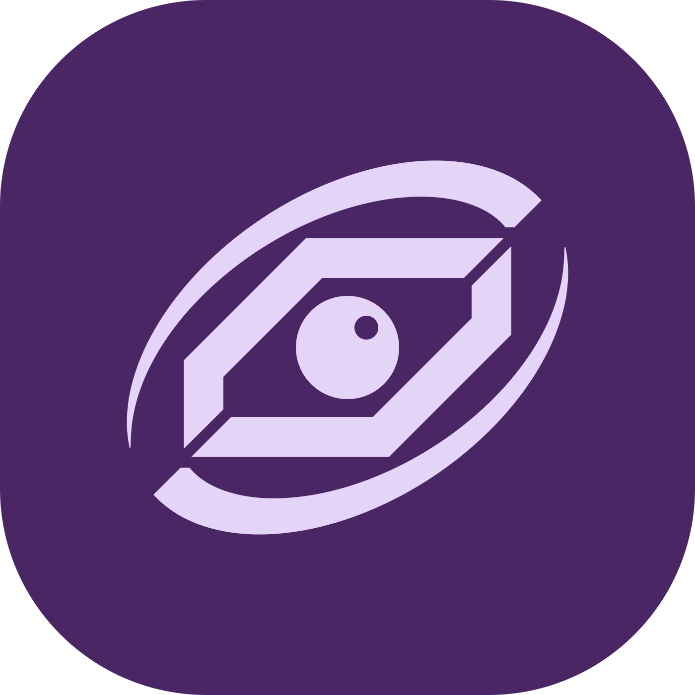
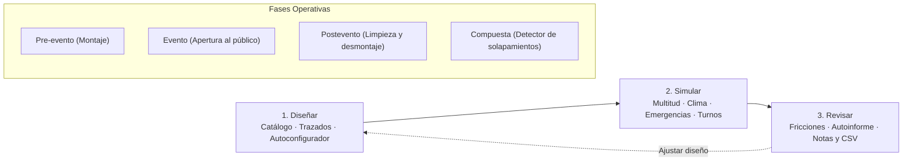

<div align="center">



# Ojo de Buey · OxEye

**Espacio para anticiparse · Laboratorio de eventos**

*Un plano para conversar, un modelo para ensayar.*

[](./package.json)
[](https://react.dev/)
[](https://www.typescriptlang.org/)
[](https://vite.dev/)

[Propósito](#-qué-busca-ojo-de-buey) · [Cartografía](#-ámbito-cartográfico) · [Capacidades](#-espacios-de-trabajo-y-capacidades) · [Stack y Estructura](#-stack-tecnológico-y-estructura) · [Inicio Rápido](#-inicio-rápido)

</div>

---

## 🎯 ¿Qué busca Ojo de Buey?

Organizar un evento en el espacio público suele obligar a decidir a ciegas entre planos estáticos, hojas de cálculo aisladas e intuición. **Ojo de Buey (OxEye)** nace como un laboratorio interactivo de planificación espacial, gestión logística por fases y simulación multi-agente en vivo sobre cartografía georreferenciada real.

El objetivo del proyecto es **anticipar fricciones antes del montaje**:

- 🗺️ **Un plano para conversar**: permite a equipos municipales, producción, seguridad y ciudadanía visualizar sobre el terreno real dónde va cada carpa, puesto, acceso o reserva logística.
- 🧪 **Un modelo para ensayar**: simula en tiempo real cómo se mueven los asistentes, dónde se forman colas, qué ocurre si llueve sobre las mesas, cuánto tarda una ambulancia en abrirse paso o cuántas horas y operarios exige el montaje y desmontaje.
- 🔍 **Transparencia metodológica**: distingue explícitamente entre **mediciones geométricas exactas** e **hipótesis editables**, e incorpora explicaciones en lenguaje claro (`?`) en cada parámetro técnico.

---

## 🗺️ Ámbito Cartográfico

Contextualizado inicialmente en **San Cristóbal de La Laguna (Santa Cruz de Tenerife)** bajo el sistema de referencia **UTM Zona 28N (`EPSG:32628`)**, combinando cartografía vectorial de **OpenStreetMap** y ortofotos aéreas **PNOA-IGN**:

| Clave | Recinto | `bbox` (`EPSG:32628`) | Dimensiones | Resolución PNOA |
| :--- | :--- | :--- | :--- | :--- |
| `cristo` | **Plaza del Cristo** *(Casco Histórico)* | `[371250, 3152300, 371750, 3152700]` | `500 × 400 m` | `0,20 m/px` |
| `constitucion` | **Parque de la Constitución** *(Camino Largo)* | `[370990, 3152350, 371400, 3152760]` | `410 × 410 m` | `0,25 m/px` |
| `vega` | **Parque de La Vega** *(Pedro González)* | `[371260, 3152710, 371700, 3153080]` | `440 × 370 m` | `0,25 m/px` |

> [!TIP]
> El visor SVG interactivo permite alternar entre **Modo Plano** y **Modo Ortofoto**, activar cuadrículas alfanuméricas (`5 m`, `10 m`, `20 m`, `50 m`) y consultar la posición exacta de cualquier elemento en metros locales y coordenadas UTM.

---

## 🔄 Fases Operativas y Flujo de Trabajo

Ojo de Buey articula el ciclo completo de un evento en **4 vistas de fase** y **3 espacios de trabajo**:



| Fase | Color | Enfoque operativo |
| :--- | :---: | :--- |
| **Pre-evento** (`pre`) | 🟧 `#89561d` | Limpieza previa, acceso de camiones, descarga con carretillas y montaje por lotes. |
| **Evento** (`event`) | 🟩 `#175e58` | Apertura al público, actividad comercial/gastronómica, flujo peatonal y emergencias. |
| **Postevento** (`post`) | 🟪 `#77548d` | Limpieza entre jornadas o desmontaje final, retirada de residuos y carga. |
| **Compuesta** (`all`) | ⬛ Mixta | Superposición de todas las fases con **analizador geométrico de solapamientos** (conflictos reales vs. usos sucesivos compatibles). |

---

## 🧩 Espacios de Trabajo y Capacidades

### 01 · Diseñar
- **Catálogo de 27 piezas** (hasta `150` elementos por recinto): puestos de artesanía/libros/producto local, ventorrillos, foodtrucks, talleres, escenarios, zonas de descanso, mesas picnic, carpas, aseos, contenedores, accesos configurables, recursos de emergencia y reservas logísticas.
- **Autoconfigurador espacial**: reorganiza el montaje existente o distribuye nuevo inventario con 3 estrategias (*Patio central*, *Paseo longitudinal* e *Islas de actividad*) mediante vista previa no destructiva.
- **Trazados e Inspector**: dibujo de perímetros, zonas excluidas, recorridos peatonales y propuestas viales; edición precisa de dimensiones, rotación, precio, capacidad, nivel sonoro (`dB`), bloqueo (`locked`) y etiquetas de fase.
- **Capa «Rayos X» (subsuelo y mapa de calor estructural)**: toggle dedicado en el panel Capas (`#xray-layer`), perímetro booleano del subsuelo (`Mayús` añade `+`, `Ctrl` resta `−`) independiente del recinto del evento, columnas circulares con calor radial y muros de carga rotables con banda simétrica de restricción de carga calculada mediante función pura (`structuralHeat` / `calor`).
- **Selección múltiple y atajos**: `Shift + clic` para multiseleccionar cualquier elemento colocable (incluyendo el subsuelo), con resumen en el Inspector y atajos `Ctrl+C` / `Ctrl+V`, `Supr` (respetando `locked` y el límite de 150 piezas) y `Ctrl+Z` / `Ctrl+Y`.

### 02 · Simular
- **Motor multi-agente (`EventEngine`)**: malla de navegación de `0,75 × 0,75 m`, campos de flujo BFS con caché LRU y evasión local de colisiones.
- **Población sintética realista**: catálogo determinista de **1.000 perfiles ficticios** ajustados al padrón de San Cristóbal de La Laguna (`167.176` habitantes), con presupuesto, ritmo de marcha, paciencia, arquetipo y preferencia de refugio.
- **Comedor y clima (`Dining`)**: gestión de mesas picnic bajo lluvia, secado por operarios y registro de comidas de pie por falta de plazas secas.
- **Modo Director en vivo**: control de clima (*Sol*, *Nubes*, *Lluvia*, *Viento*), luz solar (`6:00`–`23:00`), vista inmersiva a pantalla completa, lentes de lectura (*Personas*, *Flujos*, *Esperas*) y disparo en vivo de incidencias (**Caída**, **Incendio**, **Corte**, **Conflicto**) con patrullas `Watch`, primera intervención y cinemática de vehículos de emergencia con cesión de paso peatonal.
- **Simulador de jornada logística (`Pre` y `Post`)**: modelado de camiones, carretillas, cuadrillas por empresa adjudicataria y vaciado de residuos hasta el balance de jornada.

### 03 · Revisar
- **Monitor automático de experiencia**: detecta 7 categorías de fricción (*precio*, *cola*, *bloqueo*, *salida*, *refugio*, *sonido en dB*, *falta de oferta*) y sugiere desplazamientos geométricos libres de colisión.
- **Autoinforme del motor**: ejecuta ensayos comparativos de `15 min` en segundo plano con mutaciones candidatas y presenta una comparativa con minimapas SVG.
- **Notas y mediciones**: observaciones georreferenciadas por celda y mediciones planimétricas exportables a **CSV compatible con Excel** (UTF-8 BOM, separador `;` y coordenadas UTM) o **JSON**.

<details>
<summary><strong>📦 Módulos de Gestión y Laboratorio en Cabecera</strong></summary>

1. **Asistente de creación (Wizard en 4 pasos)**: configuración de ubicación, calendario (`1–30` días), horario y carácter del evento con gráfico radar SVG.
2. **Calcular servicios**: estimación inicial de puestos, mesas, carpas, comercios y aseos a partir de 17 variables de demanda.
3. **Inventario**: control de stock por categoría con inserción manual o propuesta automática en minimapa.
4. **Laboratorio comparativo**: baterías de `3`, `6` o `10` diseños simulados (`15`, `30` o `60 min`, con opción de lluvia e inyección automática de emergencias) y ranking ponderado exportable.
5. **Contactos y Empresas**: directorio de proveedores con preparación de correo/WhatsApp y asignación de lotes/recursos por empresa.
6. **Ficha de producción**: 17 parámetros operativos y estimación en tiempo real de duración y coste salarial de turnos.

</details>

---

## 🛠️ Stack Tecnológico y Estructura

- **Interfaz y Tipado**: React 19 + TypeScript estricto + CSS modular con estética editorial/cartográfica.
- **Empaquetado**: Vite 6.
- **Estado**: Zustand 5 (desacoplado de la referencia mutable de alta frecuencia del motor para mantener fluidez en el lienzo SVG).
- **Persistencia**: Drizzle ORM + Dexie (IndexedDB) + importación/exportación completa en JSON (`Ojo_de_Buey_Proyecto.json`) y CSV.
- **Calidad y Testing**: ESLint (Google TypeScript Style / `gts`), Prettier, TypeDoc, Vitest (unitarios) y Playwright (E2E).

```text
OxEye/
├── public/                 # Favicon SVG y ortofotos PNOA (cristo, constitucion, vega)
├── src/
│   ├── components/         # UI React (header, layout, map, simulation, modals, menu, common)
│   ├── data/               # Catálogo de piezas, cartografía JSON, mapas y textos en lenguaje claro
│   ├── db/                 # Esquema Drizzle y repositorio de persistencia
│   ├── engine/             # Motor puro TS (cartography, crowd, dining, director, emergency, experience, logistics, planning, subsoil)
│   ├── store/              # Store principal de Zustand (useProjectStore)
│   ├── styles/             # Hojas de estilo modulares
│   └── types/              # Definiciones de tipos TypeScript
├── tests/
│   ├── unit/               # Tests unitarios del motor con Vitest
│   └── e2e/                # Tests End-to-End con Playwright
├── doc/                    # Documentación de origen y prototipo inicial
└── SPECIFICATIONS.md       # Especificaciones técnicas y funcionales detalladas
```

---

## 🚀 Inicio Rápido

### Requisitos previos
- **Node.js** `>= 20` y **npm**.

### Instalación y desarrollo

```bash
# 1. Clonar el repositorio
git clone https://github.com/FabianGonzalezLence/OxEye.git
cd OxEye

# 2. Instalar dependencias
npm install

# 3. Iniciar el servidor de desarrollo
npm run dev
```

### Scripts disponibles

| Comando | Descripción |
| :--- | :--- |
| `npm run dev` | Inicia el servidor de desarrollo con Vite. |
| `npm run build` | Compila TypeScript (`tsc -b`) y genera el bundle de producción. |
| `npm run preview` | Previsualiza localmente el build de producción. |
| `npm run test` | Ejecuta los tests unitarios del motor con Vitest. |
| `npm run test:e2e` | Ejecuta las pruebas End-to-End con Playwright. |
| `npm run lint` | Comprueba reglas de estilo y calidad con ESLint. |
| `npm run format` | Formatea el código fuente con Prettier. |
| `npm run docs` | Genera la documentación técnica con TypeDoc. |

---

## 📚 Referencias, Créditos y Licencia

- **Cartografía y ortofotos**: Datos geográficos de [OpenStreetMap](https://www.openstreetmap.org/) (ODbL) y ortofotos del Plan Nacional de Ortofotografía Aérea ([PNOA-IGN](https://pnoa.ign.es/), CC BY 4.0).
- **Marco técnico de referencia**: *PEMU de La Laguna (2011)*, *Plan de Autoprotección del Cristo (2021)*, *Directiva 89/391/CEE* y *Manual de buenas prácticas de montaje y desmontaje del INSST (2020)*.
- **Origen del prototipo**: Basado en el prototipo inicial e idea de *Yeray López de Saja*.